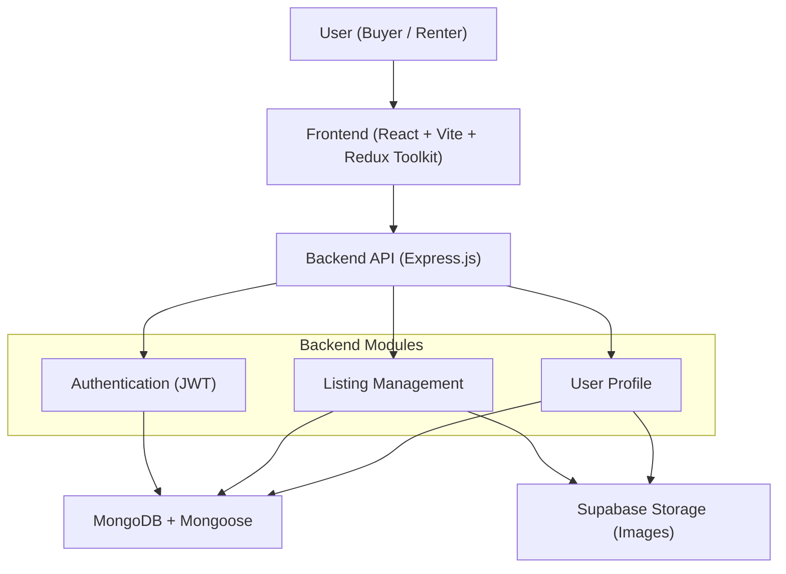
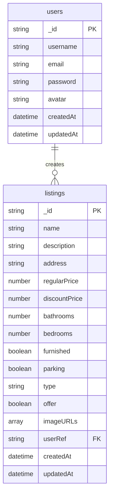
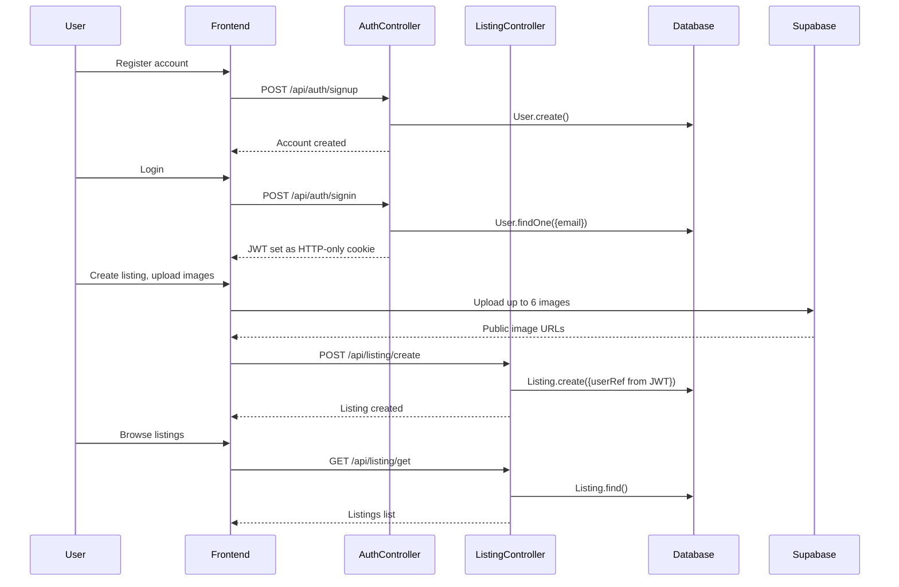
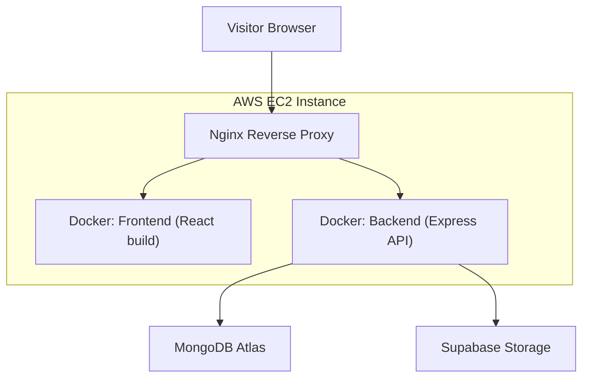

# Case Study - Real Estate MERN App: Property Listings, Containerized and Deployed on AWS

## Overview

Meet the **Real Estate MERN App**.

A full stack real estate platform where users create accounts, list properties with photos, and browse listings, built with the MERN stack and containerized for deployment on AWS EC2.

This platform lets users create an account, list a property with up to six photos, and browse other listings through a slider-driven interface. Authentication runs on JWT stored in HTTP-only cookies, and every write to a listing is tied back to the authenticated user rather than trusting anything the client sends.

Beyond the application itself, this project doubled as a DevOps exercise, containerizing the frontend and backend with Docker and deploying the result to a real AWS EC2 instance instead of a managed platform like Vercel.

## Goals of the Project

The goal of this platform is to provide a simple property marketplace where users can list their properties with photos and browse the listings of others. A second goal was to go beyond the application code and practice a hands-on deployment path, with Docker containers running on an AWS EC2 instance behind Nginx.

## System Architecture Overview

### System Architecture Diagram

The React frontend talks to an Express API split into auth, listing, and user modules, with MongoDB for data and Supabase handling image storage separately.

---

## Key Features

### Single-Role User System

This platform provides 1 main user role according to the marketplace.

- **User**: Create an account, list properties, upload photos, browse listings, manage profile

### Authentication

- **JWT authentication**: Registration and login backed by JWT tokens stored in secure, HTTP-only cookies.
- **Protected listing routes**: Creating, updating, and deleting a listing all require an authenticated session tied to that listing's owner.

### Listings with Image Uploads

- **Multi-image listings**: Up to six images per listing, uploaded to Supabase Storage with client-side type and size validation.
- **Database storage**: Only the resulting public URLs get saved to MongoDB, not the image files.
- **Image slider**: Listing photos browse through a Swiper-powered slider rather than a static gallery grid.

### Ownership Enforced Server Side

- **Server side `userRef`**: Every listing is tied to a `userRef` field, but that value is never read from what the client submits. It's derived from the authenticated JWT on the server, so there's no way to submit a listing under someone else's account by tampering with a request body.

### Profile Management

- **Update details**: Users can update their profile details.
- **Profile picture**: Users can change their profile picture.
- **Delete account**: Users can delete their account entirely.

### Containerized Deployment

- **Docker**: Frontend and backend both run in separate Docker containers.
- **AWS EC2**: The app is deployed to a real EC2 instance behind Nginx, rather than a managed hosting platform.

### API Architecture

**Authentication**
- `/api/auth/signup`
- `/api/auth/signin`

**Listing Management**
- `/api/listing/create`
- `/api/listing/get`

### At a Glance

| Metric | Value |
|---|---|
| Max images / listing | 6 |
| User roles | 1 |
| Storage | Supabase |
| Auth | JWT |

## Tech Stack

### Backend

**Frameworks & libraries**
- **Node.js**: For creating & running JavaScript on the server.
- **Express.js**: Light Node.js framework for backend logic.
- **MongoDB**: NoSQL database for storing data as scalable documents.
- **Mongoose**: Object modeling for MongoDB.
- **JWT**: Secure user authentication based on tokens set in HTTP-only cookies.

### Frontend

**Frameworks & libraries**
- **React with Tailwind CSS**: For UI designing.
- **Vite**: Light-weight frontend build tool for dev servers.
- **Redux Toolkit**: For global state management.
- **React Router**: For client-side routing.
- **Swiper.js**: For the listing image slider.

### File & Media Handling

- **Supabase Storage**: Handles image uploads, with only public URLs saved in MongoDB.

### Development & Deployment Tools

- **Docker**: Frontend and backend are containerized separately.
- **AWS EC2**: Cloud instance that hosts the containers.
- **Nginx**: Reverse proxy that acts as the entry point in front of both containers.

## Challenges & Solutions

| Challenge | Solution |
|---|---|
| A client could potentially spoof the listing owner by sending an arbitrary `userRef` value in the request body. | `userRef` is derived from the authenticated JWT on the server instead of ever being trusted from what the frontend submits. |

## Database Design

Two collections, users and listings, connected through a `userRef` field on each listing.

---

### User Flow

Registration and login issue a JWT cookie, then creating a listing uploads images to Supabase first and only stores the resulting URLs, with `userRef` pulled from the token rather than the request.

---

### Deployment Architecture

Nginx routes traffic from the EC2 instance to the frontend and backend containers, which reach MongoDB Atlas and Supabase externally.

---

## Best Practices

### Authentication & Security

- **JWT**: Tokens are stored in HTTP-only cookies, never exposed to client-side JavaScript.
- **Protected routes**: Enforced through a `verifyToken` middleware on the backend.
- **Ownership**: `userRef` is derived from the token, never trusted from client input.

### Media Handling

- **Cloud storage**: Images are uploaded to Supabase Storage, and only public URLs are saved in MongoDB.
- **Validation**: Client-side checks on image type and size run before upload.
- **Image limit**: Up to six images per listing, browsed through a Swiper slider.

### Deployment & DevOps

- **Containers**: Frontend and backend are containerized separately with Docker.
- **Real hosting**: Deployed to an AWS EC2 instance rather than a managed platform.
- **Entry point**: Nginx is configured as the entry point in front of both containers.

### Future Improvements

- **Favorites**: Saved listings for each user.
- **Admin dashboard**: A panel to manage users and listings.
- **Google Maps**: Map integration for listing locations.
- **Messaging**: Direct messaging between users.